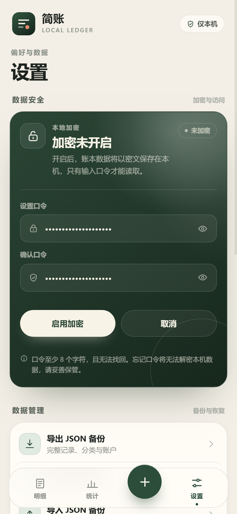
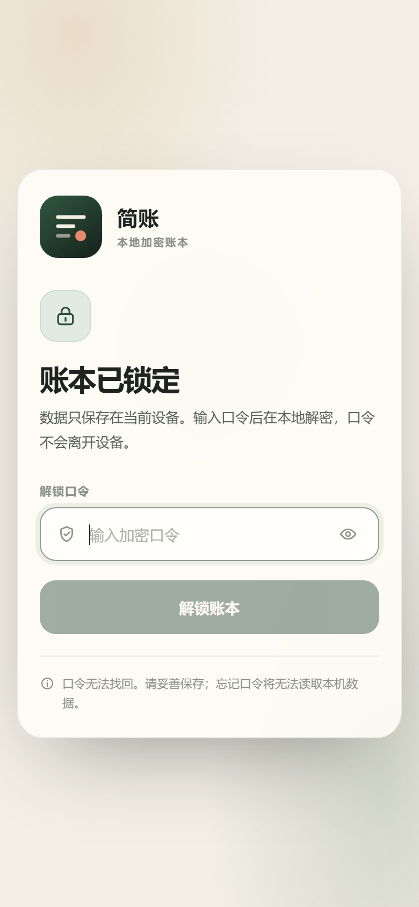

# 安全与威胁模型

版本：0.1.0-beta

## 1. 范围

简账是单机记账应用，没有账号系统、云端同步、广告、遥测或远程业务 API。多个账本的数据默认保存在当前设备/浏览器的本地 origin 存储中，各账本业务数据相互隔离。

应用的可选加密目标是：**降低设备丢失、应用数据目录被复制或备份被读取时，账本内容泄露的风险。**

## 2. 界面

| 加密启用 | 锁定界面 |
| --- | --- |
|  |  |

## 3. 数据流与信任边界

```text
用户输入
  → React UI（主线程，仅持有当前会话可见的数据）
  → 类型化 RPC
  → Storage Worker（持有会话密钥、访问 IndexedDB）
  → AES-256-GCM 密文 / 明文（未启用加密时）
  → IndexedDB
```

- UI 不接触加密密钥，也不直接访问 IndexedDB。
- 加密与解密均在 Worker 内完成。
- 应用不发起远程网络请求。Android 工程的 `INTERNET` 权限由 Capacitor WebView 的本地页面容器保留；`network_security_config` 禁止明文流量。
- 构建产物不包含第三方统计、广告或远程配置 SDK。

## 4. 加密参数

| 项目 | 参数 |
| --- | --- |
| 口令派生 | PBKDF2-HMAC-SHA256，310,000 次迭代，随机 16 字节盐 |
| 子键派生 | HKDF-SHA256，独立 info：AES-GCM 与 HMAC |
| 内容加密 | AES-256-GCM，随机 12 字节 IV/记录 |
| 完整性 | GCM tag；AAD 绑定 `entry id + monthTag` |
| 月份索引 | HMAC-SHA256（不保存明文月份） |
| 目录加密 | AES-256-GCM，固定应用上下文 AAD |
| 验证器 | 固定明文常量的 AES-GCM 密文 |
| 密钥生命周期 | 仅存在于 Worker 内存；锁定时清除 |

启用加密时会重写全部账目和分类目录；关闭加密时会再次重写为明文。两个方向都需用户明确操作，重写使用单个 IndexedDB 事务保证原子性。

## 5. 受保护的内容

启用加密后，以下内容以密文形式保存：

- 所有账本中的账目金额、类型、备注、分类引用、账户引用、发生时间、创建/更新时间；
- 所有账本中的分类名称、图标、颜色；
- 所有账本中的账户名称、图标、颜色；
- 月份索引（通过 HMAC 隐藏真实月份）。

以下内容仍以明文或可推断形式存在：

- 账本名称、颜色、ID 与账本数量；
- 每条记录顶层用于隔离账本的 `ledgerId`；
- 记录条目的数量与存储大小；
- 密文的 IV、GCM tag；
- 加密元数据：盐、迭代次数、验证器；
- 应用代码与版本信息；
- 数据文件被修改或删除的事实。

## 6. 不防护的场景

加密不提供以下保护：

1. **设备已解锁且应用会话已解锁**：系统或具有应用内代码执行能力的恶意软件可以读取 Worker 内存中的明文。
2. **操作系统级入侵**：root、调试桥、屏幕录制、输入法记录等不受应用控制。
3. **口令泄露**：口令无法找回；弱口令可能被离线暴力破解，尽管 PBKDF2 迭代会增加成本。
4. **明文导出**：JSON / CSV 备份按当前账本导出，导出时是明文。导出文件不包含加密保护。
5. **浏览器环境**：同一 origin 下的恶意脚本或其他浏览器扩展可能读取 IndexedDB 或页面内存；应用侧无法完全阻断。
6. **元数据分析**：攻击者可能根据密文数量、长度与修改时间推断使用频率。

## 7. 设备与平台策略

- Android `allowBackup=false`，避免系统将未加密账本自动备份到云端。
- Android 禁止明文网络流量（`cleartextTrafficPermitted=false`）。
- 不使用 WebView 远程调试开关；发布构建应关闭 WebView 调试。
- 应用没有账号、同步或分析标识符。

## 8. 数据删除

- “清空全部数据”会删除所有账本、`entries`、`kv` 以及加密元数据，恢复一个默认账本和默认分类/账户，并回到未加密状态。
- Android 卸载应用会删除应用数据目录。删除前应先导出所需备份。
- IndexedDB 删除不保证物理介质立即擦除；对高敏感场景，应结合设备级加密与安全擦除策略。

## 9. 安全相关的开发规则

- 不在日志中输出账目明文、口令、密钥或完整备份内容。
- 不把密钥写入 `localStorage`、URL、DOM 属性或截图。
- 加密数据重写必须在事务外完成密码学计算，事务内只执行 IDB 写入。
- 新增数据字段时必须确认是否纳入密文载荷；除账本隔离所必需的 `ledgerId`、月份 HMAC 索引外，不新增明文业务字段。
- 任何网络功能都必须先更新本文档的威胁模型，并默认保持关闭。
- 引入第三方依赖前检查其网络行为、遥测与许可。

## 10. 报告问题

安全问题应通过私有渠道报告给维护者，不应在公开 issue 中披露可利用细节、真实账本数据或口令。仓库公开后应在 GitHub Security Advisories 中提供报告入口。
