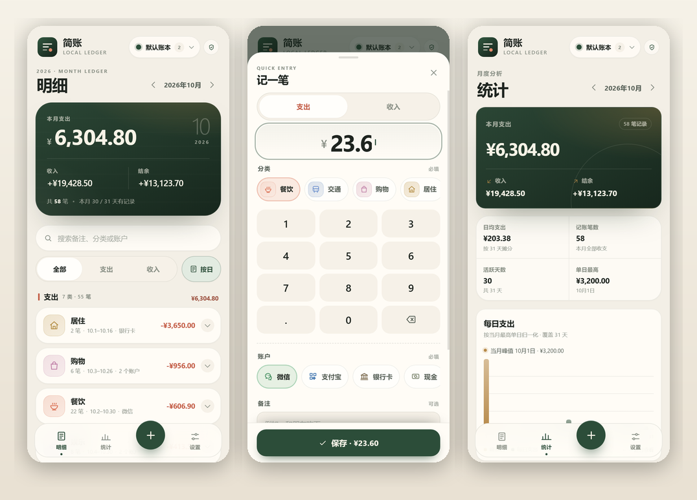
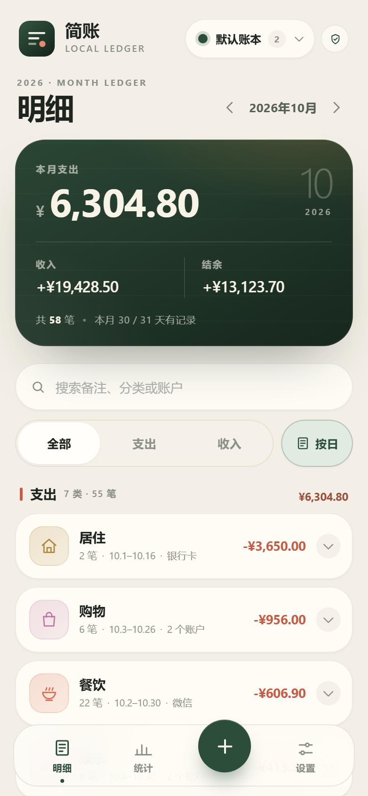
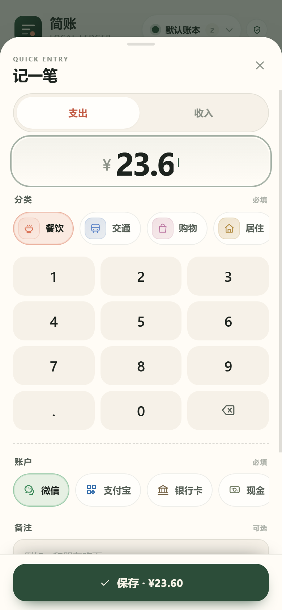
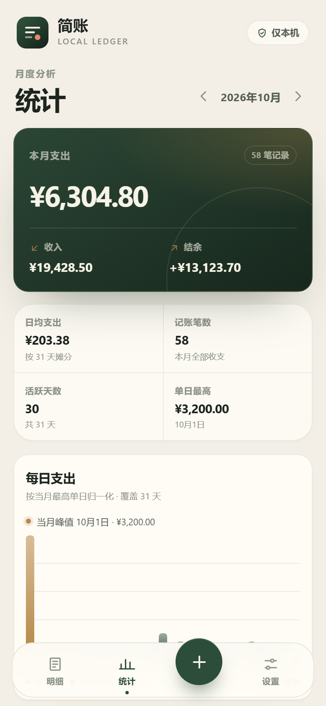
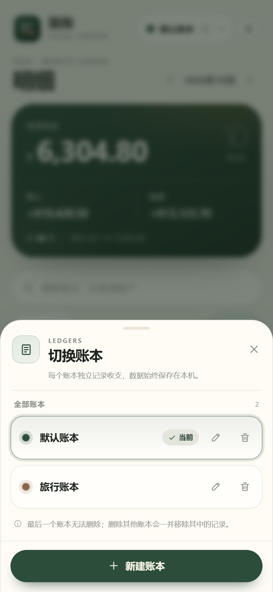
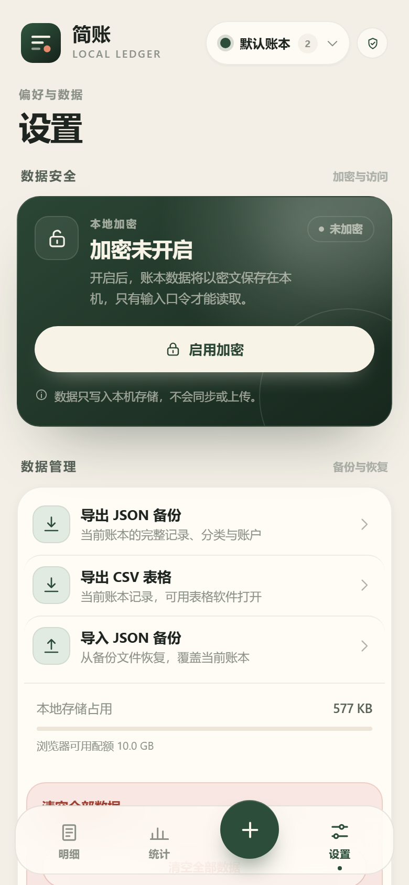
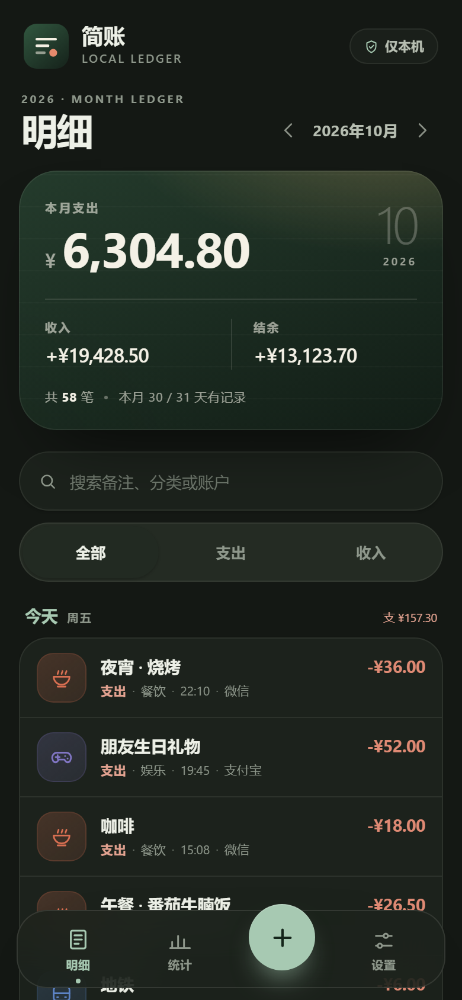
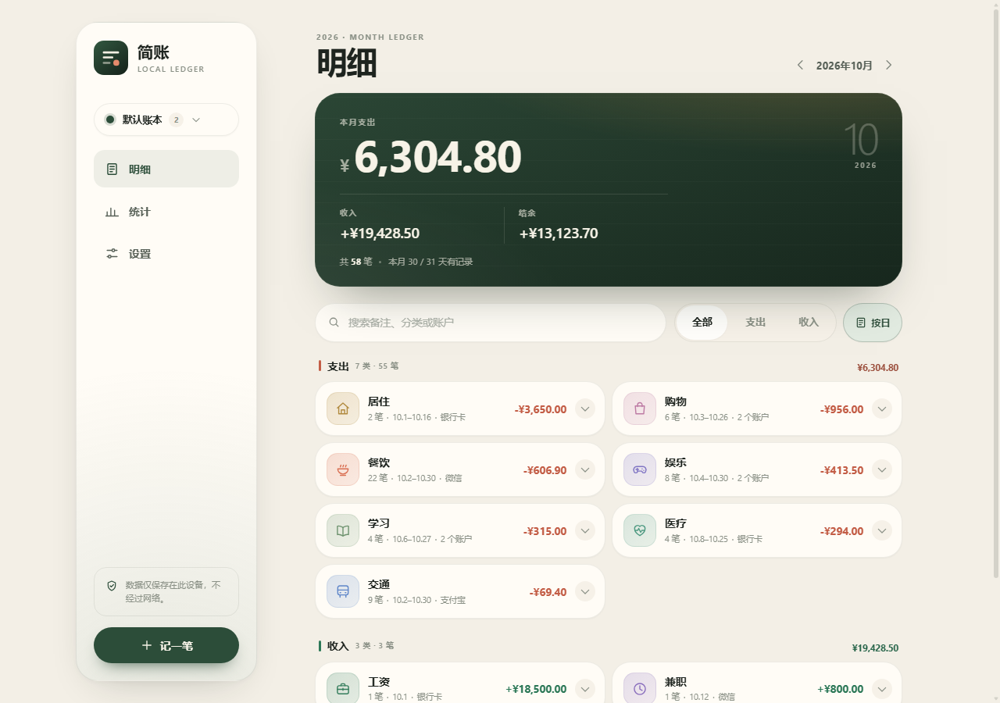
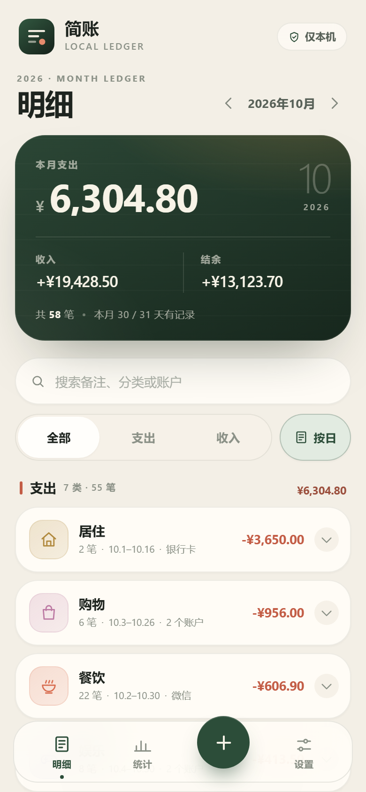
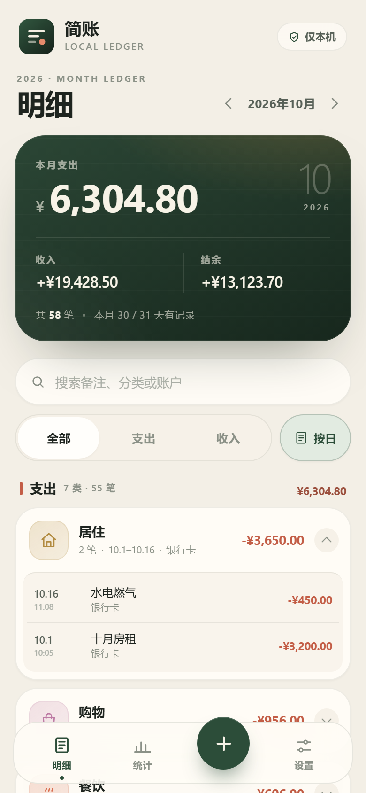

# 简账 · LedgerLite

简账是一款离线优先的 Android / Web 记账应用。界面运行在 React 前端，账本数据由独立的 Web Worker 数据服务管理，写入设备本地的 IndexedDB；支持可选的本地加密、快速记账、月度统计与完整的数据导入导出。

当前版本：**0.1.0-beta**



## 功能

- **多账本**：不同账本拥有独立的分类、账户、账目与月度统计；支持新建、切换、重命名和删除。升级前的单账本数据会自动迁移到“默认账本”。
- **快速记账**：金额 → 分类 → 保存的短路径、自定义数字键盘、按类型记忆常用分类与账户。
- **完整账本**：月度收支与结余、按日分组的明细、日小计、搜索与收支筛选。每条记录保留日期、时间、分类、账户、备注和金额；可切换“按分类汇总”，将同类多笔账目折叠为小计行，展开后查看每一笔原始明细。
- **月度统计**：月度摘要、KPI、每日支出柱状图、支出/收入分类构成；另可切换“总统计”，顶部为「总流水」（收入 + 支出绝对值合计），网格含总收入、总支出与「结余」（收入 − 支出），并按时间倒序列出全部条目。
- **离线本地存储**：所有账本数据保存在设备本地，无账号、无云端同步、无业务网络请求。
- **可选加密**：使用 PBKDF2-SHA256 与 AES-256-GCM 加密所有账本的账目与分类目录；口令只在本机内存中参与派生，不上传、不存储明文。
- **数据自主管理**：启用加密后，JSON 备份使用当前账本口令加密导出，导入时校验口令；未加密时导出普通 JSON。导入会新建账本保存备份数据，不覆盖现有账本；兼容旧版 schema 1 明文/加密备份。另支持明文 CSV、分类与账户维护、清空全部账本。Android 版本通过系统分享面板保存或发送导出文件。
- **现代界面**：响应式布局、浅色/深色跟随系统、纯 CSS 动效（统计切换滑块、筛选滑块、底部导航过渡、预测式返回手势），遵循 `prefers-reduced-motion`；设置中可开启「高刷新率」，在支持的 Android 设备上请求最高刷新模式并缩短动画时长。
- **系统返回**：Android 返回键/侧滑按“关闭面板 → 回到明细 → 退出预览”的顺序处理；统计/设置页侧滑时整页抬起显示目的地预览，越过阈值松手返回，滑回则取消。首次在首页返回提示“再返回一次退出”。
- **Android 打包**：内置 Capacitor Android 工程，可构建离线 APK。

## 技术栈

| 层 | 技术 |
| --- | --- |
| 界面 | React 19、TypeScript、手写 CSS |
| 数据服务 | Dedicated Web Worker、Typed RPC、原生 IndexedDB、Web Crypto |
| 构建 | Vite 8、Vitest、Capacitor 8 |
| 目标平台 | Android 7.0+（Capacitor `minSdk 24`）、现代浏览器 |

## 架构

```text
┌──────────────────────────────────────────────┐
│ React UI（主线程）                            │
│ 页面 / 表单 / 图表 / CSS 动效                  │
│ 不直接访问 IndexedDB 或加密密钥                │
└──────────────────────┬───────────────────────┘
                       │ Typed RPC（postMessage）
┌──────────────────────▼───────────────────────┐
│ Storage Worker（数据服务）                    │
│ LedgerEngine / 查询 / 统计 / 校验 / 加解密     │
└──────────────────────┬───────────────────────┘
                       │ IndexedDB transaction
┌──────────────────────▼───────────────────────┐
│ 设备本地存储                                  │
│ ledgers（账本） + entries（账目） + kv（目录）  │
│ + 加密元数据                                   │
└──────────────────────────────────────────────┘
```

数据层可独立在 Node + `fake-indexeddb` 中测试，不依赖 React 或浏览器 UI。协议契约位于 `src/shared/types.ts`。

### 加密设计

- 口令通过 PBKDF2-SHA256（310,000 次）派生 256 位主密钥，再用 HKDF-SHA256 分离 AES-GCM 与 HMAC 子键。
- 每条记录使用独立 12 字节 IV；AAD 绑定记录 ID 与月份索引；每个账本的分类目录同样加密。
- 月份索引使用 HMAC-SHA256，不直接存储明文年月；加密覆盖全部账本。
- 密钥只驻留在 Worker 内存中；锁定后清除会话密钥。
- 启用加密后，JSON 备份使用同一账本口令加密；导入时需要输入该口令，CSV 仍为明文。
- 账本名称、颜色与隔离用 `ledgerId` 保持明文，用于账本切换和索引。
- 加密为可选功能，默认关闭。启用加密或关闭加密均需要显式操作。

> 加密保护静态存储，不防护已解锁设备上的内存读取、系统级恶意软件或被绕过的操作系统权限。JSON / CSV 导出文件为明文，请自行妥善保管。口令无法找回。

详细的安全模型见 [安全说明](Document/security.md)。

## 快速开始

环境要求：Node.js 22.12+、npm 10+。

```bash
npm ci
npm run dev
```

打开终端输出的本地地址即可。Web 版数据同样存储在浏览器当前 origin 的 IndexedDB 中。

常用命令：

```bash
npm run typecheck   # TypeScript 严格检查
npm test            # 单元测试
npm run build:web   # 构建静态 Web 产物（输出到 dist/）
```

### 验证覆盖

- TypeScript 严格模式：0 错误。
- Vitest：10 个测试文件、58 个用例，覆盖金额与日期工具、加密参数与篡改检测、单账本 CRUD、多账本隔离与 v1→v2 迁移、统计、加密启停、按账本备份导入导出、导入新账本、schema 1 旧备份兼容与加密备份口令校验。
- 浏览器验收：390×844、360×640 与 1280×900 视口；浅色/深色；快速记账、编辑删除、月份切换、搜索筛选、分类汇总展开、账本新建/切换/删除、旧版数据迁移、加密锁定与解锁、JSON/CSV 导出与 JSON 导入。

## 构建 Android APK

前置环境：JDK 21、Android SDK Platform 36、Android Build Tools、设置 `ANDROID_HOME` 或 `android/local.properties`。

```bash
npm ci
npm run android:apk
```

产物路径：

```text
android/app/build/outputs/apk/debug/app-debug.apk
```

发布签名、架构与体积说明见 [Android 构建](Document/android-build.md)。

## 项目结构

```text
src/
  shared/       领域类型、金额/日期工具、校验与 API 契约
  backend/      IndexedDB、加密、LedgerEngine、Worker RPC
  frontend/     React 界面、页面、组件、样式与 Worker 客户端
tests/          数据层测试
android/        Capacitor Android 工程
public/         应用图标、Web Manifest
Document/       架构、安全、构建与开发文档
```

## 设计约束

- 数据层与 UI 层通过类型化 RPC 通信；UI 不直接触达存储实现。
- 金额以整数分存储与计算，不使用浮点数做账。
- 不使用第三方组件库、图表库、图标库或网络字体，减少传输体积与解析开销。
- 动效尽量只改变 `transform` 与 `opacity`；尊重系统的减少动画设置。
- 新功能若增加常驻内存、常驻定时器或持续网络请求，需要先评估性能影响。

## 界面

| 明细 | 快速记账 | 统计 |
| --- | --- | --- |
|  |  |  |

| 账本切换 | 设置 | 深色模式 | 桌面端 |
| --- | --- | --- | --- |
|  |  |  |  |

| 分类汇总 | 展开明细 |
| --- | --- |
|  |  |

## 文档

- [架构说明](Document/architecture.md)
- [安全与威胁模型](Document/security.md)
- [开发指南](Document/development.md)
- [Android 构建](Document/android-build.md)
- [变更记录](CHANGELOG.md)

## 许可证

[MIT](LICENSE)
